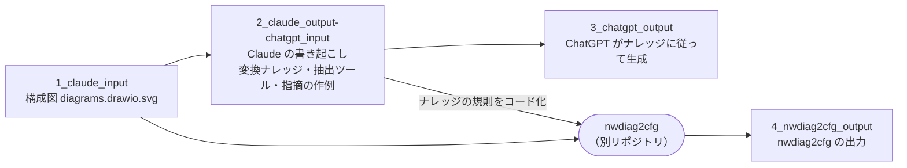

# nwdiag2cfg_samples

ネットワーク構成図（drawio の「物理・論理合成図」）から NW 機器のコンフィグを作るトライアルの、入力・中間成果物・出力をまとめたリポジトリです。
同じ図を「AI（Claude）が読んで書き起こす」「AI（ChatGPT）がナレッジ文書に従って変換する」「ツール [nwdiag2cfg](https://github.com/corestate55/nwdiag2cfg) で AI を介さずに変換する」の3通りで処理し、結果を比べられるようにしています。

## 流れ



1. Claude が構成図を読み、全 NW 機器のコンフィグを根拠付きで書き起こしました（基準となるトライアル）。
2. その経験から、図の表現規約・変換規則・チェック項目を「図からコンフィグ変換ナレッジ」にまとめました。
3. ChatGPT にナレッジと図を渡して変換させ、ナレッジだけで同等の結果が出るかを確かめました。
4. ナレッジの規則をそのままコードにした CLI ツール nwdiag2cfg を作り、AI を介さずに同じ図を変換しました。

## ディレクトリ

| ディレクトリ | 内容 |
|---|---|
| `1_claude_input/` | 入力の構成図 `diagrams.drawio.svg`。対象タブは「物理・論理合成図_4C」（カラー版）。補助として「論理構成図_4C」も使う |
| `2_claude_output-chatgpt_input/` | Claude の成果物で、ChatGPT への入力にもしたもの |
| ├ `図からコンフィグ書き起こし_トライアル.md` | Claude による書き起こし（結線表・セグメント表・全機器のコンフィグと根拠） |
| ├ `図からコンフィグ変換ナレッジ.md` | 変換ナレッジ v1.1（表現規約、変換規則、機種の判定と Cisco 記法へのフォールバック、チェック ID 体系 N/A/V/P/L/M/X/D、指摘一覧の書式） |
| ├ `tools/drawio_nwdiag_extract.py` | drawio から機器・結線・VLAN 所属・警告を抜き出す補助ツール |
| └ `example_BPDF/` | 指摘一覧の書式の作例（19 件） |
| `3_chatgpt_output/` | ChatGPT がナレッジ v1.1 と図から生成したコンフィグ 18 台、変換レポート、指摘一覧（24 件）、TBD 一覧 |
| `4_nwdiag2cfg_output/` | nwdiag2cfg 0.1.0 の出力（`diagrams/` 以下）。コンフィグ 18 台、`configs.md`、`review.md` / `review.csv`（ERROR 4・WARN 38・INFO 16 件） |

## nwdiag2cfg との関係

[nwdiag2cfg](https://github.com/corestate55/nwdiag2cfg) は、`2_…/図からコンフィグ変換ナレッジ.md`（v1.1）の規則を Python で実装した CLI です。
AI に同じナレッジを読ませて変換させたときと同じ形の出力（コンフィグ、変換レポート、指摘一覧）を、決まった手順で再現します。
このリポジトリは、nwdiag2cfg の作るものが「AI がナレッジに従って作るもの」と比べてどうかを確かめるための材料置き場です。

`4_nwdiag2cfg_output/` は次のコマンドで作りました。

```bash
git clone https://github.com/corestate55/nwdiag2cfg
nwdiag2cfg/bin/nwdiag2cfg -f 4_nwdiag2cfg_output/diagrams.drawio.svg \
  -t 物理・論理合成図_4C --aux-tab 論理構成図_4C -o 4_nwdiag2cfg_output/diagrams
```

既定値ファイル（`-p`）は指定していないので、設計判断はすべてナレッジ v1.1 の既定値です（LACP active、VRRPv3、01号機の優先度 110 など）。

### 3通りの結果を見比べるときの注意

- **大阪コアの Po1**: 書き起こし（`2_…/図からコンフィグ書き起こし_トライアル.md`）は VLAN2 を通していますが、これは誤りです。未接続の線（cell `-119`）は EXT の横線と GRT をつなぐ線で、Po1 とは関係がありません。正しくは `9-11,300-399` で、ChatGPT と nwdiag2cfg はどちらもこの値になっています。書き起こしの文書は修正していません。
- **名前が重複している機器**: 図では Rack2 のアクセス SW が `tk1-sr1acc01/02`、フロア SW が2台とも `tk1-fnacc01` になっています。ChatGPT は推測で `tk1-sr2acc01/02`・`tk1-fnacc02` と名前を付け直しました。nwdiag2cfg は図の名前を残して `-dup2` を付け（例: `tk1-sr1acc01-dup2`）、N-01 の指摘を出します。
- **作例 `example_BPDF/`**: 同じ図の指摘なので、この図を AI に変換させるときに作例を一緒に読ませると、独立した評価になりません。書式の参考として使ってください。
- **既定値の違い**: ChatGPT と nwdiag2cfg の差の多くは、LAG モード・VRRP の書式・優先度などの既定値の選び方によるものです。どちらの出力にも、変換レポートに「既定値を使った項目」が載っています。

## 構成図データについて

`diagrams.drawio.svg` は、書籍『ネットワーク図の描き方入門』のサポートページ
（[ネットワーク図の描き方入門 | 日経BOOKプラス](https://bookplus.nikkei.com/atcl/catalog/25/11/21/02321/)）にある
「ネットワーク構成図、アイコンデータのダウンロード」からダウンロードできるデータです。

## ライセンス

[LICENSE](LICENSE)（MIT License）
